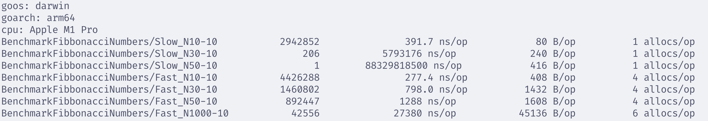

# Fibonacci Numbers in Go

This project provides two implementations for generating Fibonacci numbers in Go:
1. **Basic Version**: A naive recursive implementation with $O(2^n)$ time complexity.
2. **Fast Version**: An optimized implementation using dynamic programming (memoization) with $O(n)$ time complexity.

## Benchmarks

Here is the performance comparison between the two implementations:

### Key Takeaways
* The basic version slows down drastically even at $N=30$ due to exponential time complexity.
* The optimized version handles larger inputs almost instantly thanks to the caching mechanism.

